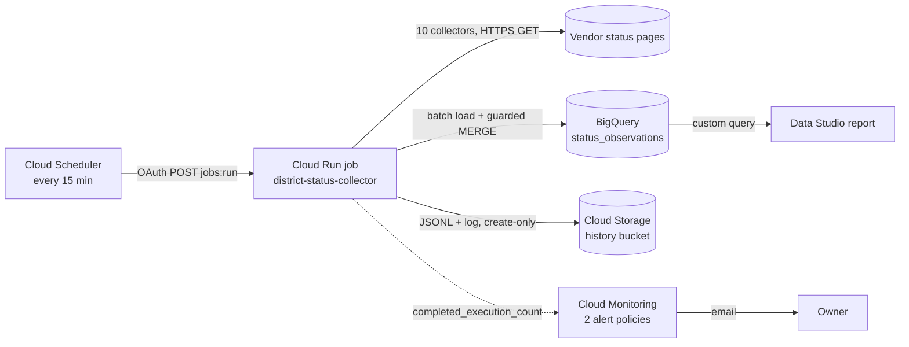

# District IT Service Status Monitor

A serverless pipeline that checks the public status pages of 10 education-technology vendors every 15 minutes, keeps the history in BigQuery, and feeds a Data Studio (Looker Studio) dashboard. It runs on Google Cloud: Cloud Scheduler starts a Cloud Run job, the job loads BigQuery and archives raw history to Cloud Storage, and Cloud Monitoring emails when runs fail.

> Portfolio project built around the services a New Jersey K-12 school district uses. It is not an official district service and is not endorsed by any district or vendor. It reads only public status pages; it does not measure district network connectivity or end-to-end application health.

## What it monitors

25 scopes from 10 collectors. Every collector uses only Python's standard library and needs no API keys.

| Vendor | Scopes | Public source | How status is decided |
| --- | --- | --- | --- |
| GoGuardian | 1 | [status.goguardian.com](https://status.goguardian.com) | Page-wide indicator |
| SmartPass | 1 | [smartpass.instatus.com](https://smartpass.instatus.com) | UP / HASISSUES / UNDERMAINTENANCE mapped to none / issues / maintenance |
| ClassLink | 1 | [status.classlink.com](https://status.classlink.com) | Page-wide indicator |
| Frontline Education | 1 | [status.frontlineeducation.com](https://status.frontlineeducation.com) | Vendor-wide summary |
| Google Workspace | 14 | [Google Workspace Status Dashboard](https://www.google.com/appsstatus/dashboard/) | Ongoing incidents by product ID: the whole feed plus Gmail, Classroom, Drive, Calendar, Meet, Docs, Sheets, Slides, Forms, Chat, Sites, Admin Console and Sign In |
| ChatGPT | 1 | [status.openai.com](https://status.openai.com) | Conversations and Login components only |
| Realtime SIS | 3 | [NodePing public report](https://nodeping.com/reports/statusevents/UWVWG8OSC0CKEBWK) | External HTTP checks; Unknown if the latest probe is over 15 minutes old |
| i-Ready | 1 | [i-ready.status.io](https://i-ready.status.io/) | Worst of nine production components |
| Cisco Meraki | 1 | [status.meraki.net](https://status.meraki.net/api) | North and South America region components only |
| Incident IQ | 1 | [status.incidentiq.com](https://status.incidentiq.com/api) | Platform and API components only |

`config/sources.json` lists every endpoint, component ID and scope note.

## Architecture



### One run, step by step

1. Cloud Scheduler calls the Cloud Run Jobs API as a dedicated service account.
2. `cloud/cloud_run_entry.py` runs `scripts/run_pipeline.py --backend bigquery --non-interactive`.
3. Each `scripts/fetch_*.py` collector reads one public feed, validates it, and appends JSON Lines to `data/status_checks.jsonl`. If a feed's structure is unexpected, the collector exits non-zero and saves nothing rather than guessing.
4. `scripts/load_status_bigquery.py` validates the batch, loads it into a per-run staging table that expires after 24 hours, and runs `sql/bigquery/002_merge.sql`. That transaction bumps a revision row (with an `ASSERT`) and merges only new `(vendor, source_type, observed_at)` keys, so replaying a batch inserts nothing twice.
5. The wrapper copies the run's JSONL and log to `gs://<bucket>/history/` and `logs/` with `ifGenerationMatch=0`, so nothing is ever overwritten.
6. The job exits non-zero if any collector or the load failed, which is what the alerts watch.

## Design choices

- **Missing data is never shown as healthy.** The latest-status view marks rows older than 30 minutes as `STALE`; failed checks become Unknown; dashboard cards show "No data", not 0.
- **Scope matches what the district uses.** Pages that cover unrelated products are narrowed to the relevant components (ChatGPT, i-Ready, Meraki, Incident IQ).
- **Least-privilege identity.** The service account has BigQuery Job User on the project, BigQuery Data Editor on the dataset only, Storage Object Creator on the bucket only, and Cloud Run Invoker on the job only.
- **Cost guard.** Every query sets `maximum_bytes_billed` (100 MiB); the history table is partitioned by day and clustered by vendor.
- **Alerts tuned on real runs.** In the first 3 days, 8 of 186 runs failed, each a one-off (mostly a vendor page returning 403 or timing out). So the alert fires on 2 or more failed runs within 45 minutes, or on no successful run for 60 minutes, not on every blip.

## Repository layout

```
cloud/cloud_run_entry.py         Cloud Run entry point: run the pipeline, archive history
config/bigquery.json             Project, dataset, location and query limits (placeholders)
config/sources.json              Inventory of every public source and scope
dashboard/                       Data Studio custom query and report settings
deploy/                          Deploy and schedule scripts
docs/DEPLOY.md                   One-time Google Cloud setup and deployment
docs/OPERATIONS.md               Health checks, pause/resume, replay, alerts
ops/setup_alerts.py              Creates or updates the Cloud Monitoring alerts
scripts/fetch_*.py               One collector per vendor
scripts/statuspage_components.py Shared validation for Atlassian Statuspage feeds
scripts/run_pipeline.py          Runs all collectors, then the BigQuery loader
scripts/load_status_bigquery.py  Validated batch load and guarded MERGE
scripts/setup_bigquery.py        Creates the dataset, table and views
sql/bigquery/                    Setup, merge and validation SQL
tests/                           Offline unit tests
Dockerfile                       python:3.13-slim image, non-root user
.gcloudignore                    Files left out of the Cloud Build upload
```

## Try it locally

Python 3.10 or newer.

```bash
# Offline tests (BigQuery tests skip unless google-cloud-bigquery is installed)
python -m unittest discover -s tests -v

# Read and validate one live feed without saving anything
python scripts/fetch_cisco_meraki_status.py --check

# Run all collectors and save JSON Lines to data/, without touching BigQuery
python scripts/run_pipeline.py --backend bigquery --collect-only
```

To load BigQuery and deploy to Google Cloud, see [docs/DEPLOY.md](docs/DEPLOY.md). Day-to-day checks are in [docs/OPERATIONS.md](docs/OPERATIONS.md), and the dashboard setup is in [dashboard/README.md](dashboard/README.md).

## Project history

1. **Workstation pipeline.** Collectors ran from Windows Task Scheduler into PostgreSQL with a Grafana dashboard.
2. **BigQuery.** The same collectors gained a validated BigQuery loader (`--backend bigquery`).
3. **Data Studio.** A private Data Studio report replaced Grafana as the shared view.
4. **Cloud Run.** Collection moved to a scheduled Cloud Run job and the Windows task was turned off.
5. **More coverage and alerts.** Cisco Meraki, Incident IQ and 10 more Google Workspace products were added, along with failure alerts and a dashboard toggle that expands Google Workspace into its products.

The original PostgreSQL loader is not part of this repository; `run_pipeline.py` keeps its `--backend postgres` path for reference.

## Limitations

- Vendor-reported status is what a vendor publishes, not measured availability.
- Meraki's public page lists only broad, critical outages.
- The Realtime check reads a public NodePing report endpoint whose format is not guaranteed.
